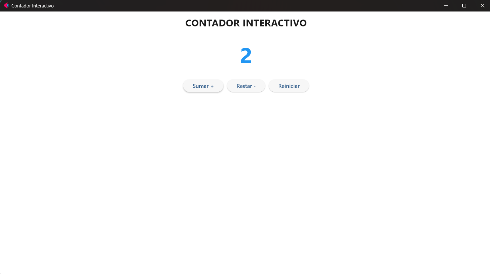

# TALLER DE INVESTIGACIÓN: EXPLORANDO BIBLIOTECAS PARA INTERFACES GRÁFICAS EN PYTHON

**Asignatura:** Programación Orientada a Objetos  
**Biblioteca seleccionada:** Flet  
**Proyecto:** Contador interactivo  
**Autor:** Alexandro Leones Ortega

## 1. ¿Qué es Flet y cuál es su propósito principal?

Flet es una biblioteca de Python que permite desarrollar interfaces gráficas interactivas. Su propósito principal es facilitar la creación de aplicaciones con elementos visuales como botones, textos, imágenes y formularios, utilizando Python.

## 2. ¿Qué tipo de aplicaciones permite desarrollar?

- Aplicaciones de escritorio para Windows, Linux y macOS.
- Aplicaciones web.
- Aplicaciones móviles.
- Sistemas de gestión.
- Aplicaciones educativas.
- Herramientas interactivas.

## 3. ¿Cómo se instala y qué requisitos necesita?

Para utilizar Flet se necesita:

- Tener Python instalado.
- Contar con un editor de código como PyCharm.
- Instalar la biblioteca Flet.
- Tener conexión a Internet para descargar las dependencias.

Para instalar Flet:

```bash
pip install "flet[all]"
```

Para comprobar que está instalado correctamente:

```bash
python -c "import flet; print(flet.__version__)"
```

## 4. ¿Cuáles son sus principales componentes o elementos gráficos?

- **Text:** permite mostrar textos en pantalla.
- **Button:** permite crear botones interactivos.
- **Column:** organiza los elementos verticalmente.
- **Row:** organiza los elementos horizontalmente.
- **Image:** permite mostrar imágenes.
- **TextField:** permite ingresar información.
- **Container:** permite organizar y personalizar elementos.

## 5. ¿Cómo maneja los eventos del usuario?

Flet utiliza eventos para detectar las acciones que realiza el usuario dentro de una aplicación. Por ejemplo, el evento `on_click` permite detectar cuando una persona presiona un botón.

Cuando ocurre el evento, se ejecuta una función o método que realiza una acción. Después se puede actualizar la interfaz para mostrar los cambios.

En nuestro proyecto se utiliza este evento para aumentar, disminuir y reiniciar el contador.

## 6. ¿Qué ventajas y limitaciones presenta frente a Tkinter?

### Ventajas

- Permite crear interfaces gráficas modernas.
- Utiliza Python para desarrollar aplicaciones.
- Tiene diferentes componentes visuales.
- Permite crear aplicaciones web, móviles y de escritorio.
- Facilita la implementación de eventos.
- Permite trabajar con programación orientada a objetos.

### Limitaciones

- Necesita instalar dependencias adicionales.
- Puede consumir más recursos que algunas aplicaciones sencillas de Tkinter.
- Algunas características pueden variar dependiendo de la versión.
- Es necesario aprender el funcionamiento de sus componentes y eventos.

## 7. Desarrollo del ejemplo mínimo

Se desarrolló una aplicación llamada **Contador Interactivo**. Comienza mostrando el número cero y contiene tres botones:

- **Sumar:** aumenta el contador en una unidad.
- **Restar:** disminuye el contador en una unidad.
- **Reiniciar:** devuelve el contador a cero.

## 8. Explicación del funcionamiento

**¿Cómo se crea la ventana principal?** La aplicación utiliza Flet para crear y configurar la ventana principal. Se establece un título y un fondo blanco.

**¿Cómo se crean los componentes gráficos?** Se utilizan componentes como `ft.Text`, `ft.Button`, `ft.Column` y `ft.Row` para mostrar el título, el número y los botones.

**¿Qué evento se implementó?** El evento `on_click`, que detecta cuando el usuario presiona alguno de los botones.

**¿Qué función responde al evento?** Los métodos `sumar`, `restar` y `reiniciar`.

**¿Cómo se modifica la interfaz?** El método `actualizar` modifica el valor del texto del contador y utiliza `self.page.update()` para mostrar el nuevo resultado.

## 9. Reto adicional: programación orientada a objetos

La aplicación utiliza una clase llamada `ContadorApp`, que administra el contador y sus componentes gráficos.

| Método | Responsabilidad |
|---|---|
| `__init__` | Inicializar el contador y los componentes. |
| `sumar` | Aumentar el contador. |
| `restar` | Disminuir el contador. |
| `reiniciar` | Regresar el contador a cero. |
| `actualizar` | Actualizar el número mostrado en pantalla. |

Se aplican conceptos de programación orientada a objetos como clases, objetos, atributos, métodos y encapsulación básica.

## 10. Código fuente

El código completo también está en el archivo [main.py](main.py):

```python
import flet as ft


class ContadorApp:
    def __init__(self, page: ft.Page):
        self.page = page
        self.contador = 0

        self.page.title = "Contador Interactivo"
        self.page.bgcolor = ft.Colors.WHITE
        self.page.horizontal_alignment = ft.CrossAxisAlignment.CENTER
        self.page.vertical_alignment = ft.MainAxisAlignment.CENTER

        self.titulo = ft.Text(
            "Contador Interactivo",
            size=24,
            weight=ft.FontWeight.BOLD,
            color=ft.Colors.BLACK,
        )
        self.texto_contador = ft.Text(
            str(self.contador),
            size=48,
            weight=ft.FontWeight.BOLD,
            color=ft.Colors.BLUE_600,
        )

        self.boton_sumar = ft.Button("Sumar", on_click=self.sumar)
        self.boton_restar = ft.Button("Restar", on_click=self.restar)
        self.boton_reiniciar = ft.Button("Reiniciar", on_click=self.reiniciar)

        self.page.add(
            ft.Column(
                controls=[
                    self.titulo,
                    self.texto_contador,
                    ft.Row(
                        controls=[
                            self.boton_restar,
                            self.boton_reiniciar,
                            self.boton_sumar,
                        ],
                        alignment=ft.MainAxisAlignment.CENTER,
                    ),
                ],
                horizontal_alignment=ft.CrossAxisAlignment.CENTER,
            )
        )

    def sumar(self, e):
        self.contador += 1
        self.actualizar()

    def restar(self, e):
        self.contador -= 1
        self.actualizar()

    def reiniciar(self, e):
        self.contador = 0
        self.actualizar()

    def actualizar(self):
        self.texto_contador.value = str(self.contador)
        self.page.update()


def main(page: ft.Page):
    ContadorApp(page)


ft.run(main)
```

## 11. Instrucciones de ejecución

1. Descarga o clona el repositorio y entra a la carpeta del proyecto.
2. Instala las dependencias:

   ```bash
   pip install -r requirements.txt
   ```

3. Ejecuta la aplicación:

   ```bash
   python main.py
   ```

## 12. Evidencias del proyecto

Captura de la aplicación funcionando, donde los botones responden a las acciones del usuario:



## 13. Conclusión

Con este trabajo aprendí a utilizar Flet para crear interfaces gráficas con Python. También comprendí cómo funcionan los eventos del usuario y cómo se pueden aplicar los conceptos de programación orientada a objetos en una aplicación interactiva.

## 14. Fuentes consultadas

1. Documentación oficial de Flet: https://flet.dev/docs/
2. Instalación de Flet: https://flet.dev/docs/getting-started/installation/
3. Controles de Flet: https://flet.dev/docs/controls/
4. Documentación oficial de Tkinter: https://docs.python.org/3/library/tkinter.html